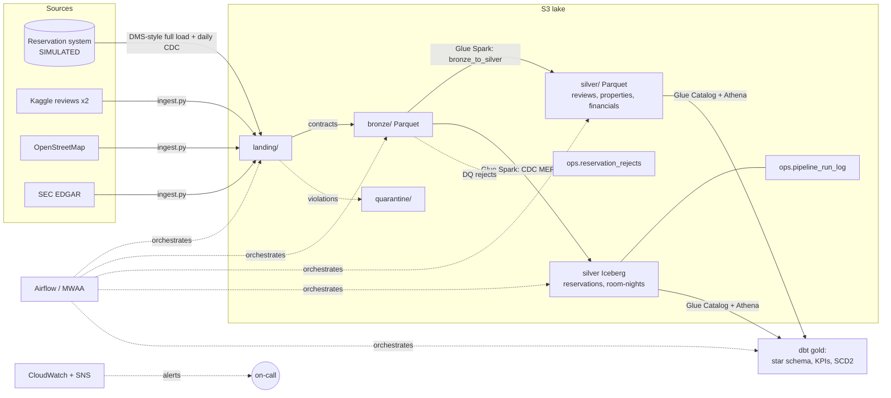

# Marriott Hospitality Data Platform

An AWS lakehouse for hotel analytics. It combines **public** data about Marriott
International (guest reviews, property locations, SEC financials) with a **simulated**
reservation system feed. The platform is built with enterprise patterns:
- incremental CDC loads into Apache Iceberg
- Airflow orchestration
- data contracts, quarantine and reject tables
- a run audit log
- dbt with SCD2 history
- Terraform
- Jenkins CI/CD
- freshness SLAs and an on-call runbook

> **About the data:** reviews, property locations and financials are real public
> datasets. **Reservation data is synthetic**, generated by
> [`pipeline/simulator/crs.py`](pipeline/simulator/crs.py), because hotel booking data
> is not public. It is not real Marriott booking data.

**Business questions**
* How do occupancy, ADR (average daily rate) and RevPAR (revenue per available room)
  compare across brands and tiers? What do cancellations, booking channels and lead
  times look like?
* What is already on the books for the next 90 days?
* How does guest sentiment vary by brand and market, and does it track reported results?

## Architecture



### Layers

| Layer | Reference data (reviews, properties, financials) | Reservations (simulated system) |
|---|---|---|
| Landing | Raw files from Kaggle, OpenStreetMap and SEC | DMS-style Parquet: one full load, then daily CDC (`Op` = I/U/D, `_cdc_seq`) |
| Bronze | Contract check (columns, row counts, parseable); typed-as-string Parquet plus lineage columns; manifest; bad files go to `quarantine/` | Same contract framework |
| Silver | **Full snapshot** rebuild in Spark. Combines the two review sources into one schema, infers the Marriott brand, masks PII, scores sentiment, and links reviews to OSM properties by brand + distance | **Incremental Iceberg MERGE**: high-water mark from the run log, DQ rules → reject table, latest change per key, a sequence guard against late events, hard deletes, room-night explode |
| Gold (dbt) | `dim_brand`, `dim_property` (golden record), `dim_property_history` (**SCD2**), `fct_review`, `fct_financials_quarterly`, sentiment marts | `fct_reservation` (USD via FX seed), `fct_property_daily` (occupancy / ADR / RevPAR with a date spine), `mart_brand_kpis_monthly`, `mart_forward_occupancy`, `rpt_pipeline_health` |

### Why the two silver patterns differ
Reference sources are re-published as full snapshots, so overwriting is the simplest
correct approach. The reservation system emits **changes**, so silver must apply them
incrementally and correctly:

* **Watermark catch-up:** the merge reads the last successful `watermark` from
  `ops.pipeline_run_log` and processes *every* later bronze partition. A missed day
  is caught up automatically, and a re-run is a no-op.
* **Sequence guard:** `MERGE ... WHEN MATCHED AND s._cdc_seq > t._cdc_seq`. A late or
  re-delivered event can never overwrite newer state.
* **Same-batch duplicates:** a reservation created and modified on the same day
  collapses to its latest change before the merge.
* **Data-quality gate:** rule violations are written to `ops.reservation_rejects` with
  reasons and the raw record. If more than 1% of a batch fails, the run fails *before*
  touching silver, and the watermark doesn't move.
* **Audit:** every run logs its partitions, row counts (read / rejected / inserted /
  updated / deleted / stale-skipped), duration and status, including failed runs.

The merge is verified two ways: [`tests/test_cdc_merge.py`](tests/test_cdc_merge.py)
covers each edge case, and an end-to-end run reconciles silver against the
simulator's full transaction log row by row.

## Orchestration (Airflow)

[`airflow/dags/marriott_daily.py`](airflow/dags/marriott_daily.py), daily at 03:00:

```
start ─┬─ reference_data: is_refresh_day? (Mondays) → ingest ×4 → validate ×4 → silver_reference [→ crawler]
       └─ reservations:   wait_for_crs_extract (sensor, reschedule) → validate → merge_reservations_cdc
       → gold: dbt source freshness → dbt build → publish_freshness_metric → end
```

* Retries with exponential backoff. Contract validations deliberately don't retry,
  because a broken contract needs a human.
* SNS alerts on failure and SLA miss, a rate-limit pool for public APIs, and
  `max_active_runs=1`.
* `PIPELINE_ENV=local` runs Spark and dbt in the worker. `PIPELINE_ENV=aws` triggers the
  Glue jobs and crawler and runs dbt on Athena. The DAG code is identical in both.
* [`crs_simulator`](airflow/dags/crs_simulator.py) plays the upstream system locally,
  publishing each day's CDC extract at 01:00.

## Quick start (local, free)

Requires Python 3.10–3.12 and Java 17+.

```bash
make setup
make test          # fast unit tests
make test-all      # + Spark/Iceberg CDC integration tests
make demo          # sample reference data → silver → simulated reservations (full load + 3 days CDC) → Iceberg → dbt
```

Then query the results:

```bash
.venv/bin/python -c "
import duckdb; c = duckdb.connect('data/warehouse.duckdb'); c.sql('load iceberg')
print(c.sql('select brand, stay_month, occupancy, adr_usd, revpar_usd from mart_brand_kpis_monthly order by revpar_usd desc limit 10'))
print(c.sql('select run_date, status, rows_inserted, rows_updated, rows_deleted from rpt_pipeline_health'))"
```

**Airflow UI locally** (Docker): `make airflow-up`, then open http://localhost:8080.

**Real reference data:** put a Kaggle token in `~/.kaggle/kaggle.json`, run
`export SEC_USER_AGENT="Your Name you@example.com"`, then `make ingest bronze silver`.

## Deploy to AWS

```bash
make package && cd terraform
terraform init && terraform workspace select -or-create dev
terraform apply -var-file=envs/dev.tfvars
terraform output airflow_env      # environment variables for MWAA
```

What gets provisioned (validated with `terraform validate`):

| Area | Resources |
|---|---|
| Storage | Encrypted, versioned, TLS-only S3 lake + artifacts buckets with lifecycle rules |
| Compute | Glue 4.0 jobs: reference silver (Parquet) and CDC merge (Iceberg, Glue Catalog) |
| Catalog / query | Glue databases (silver / ops / gold), crawler + trigger, Athena workgroup with a 10 GB per-query cap |
| Security | Least-privilege IAM per zone; PII salt in SSM SecureString |
| Operations | SNS alerts, EventBridge failure rules for both jobs, freshness alarm (missing data = breach), dashboard, monthly budget |

**MWAA** is not in this Terraform on purpose: it needs a VPC and costs about $350/month
minimum. Point an existing MWAA environment at `airflow/dags` (Jenkins syncs them)
with the `airflow_env` output, or run the Docker image on ECS.

## CI/CD (Jenkins)

[`Jenkinsfile`](Jenkinsfile): lint → **parallel**(unit + Spark/Iceberg tests, DAG
integrity tests) → `dbt parse` → package → `terraform plan`. On `main`, it deploys to
dev automatically (infrastructure + DAG sync), then to prod after manual approval.

## Data governance

* **PII:** emails in reviews and reservations are hashed with a secret salt and never
  stored in silver. Emails, phone numbers and room numbers in review text are masked.
* **Lineage:** `_source_file` / `_ingest_date` on every bronze row, `_cdc_seq` /
  `_merged_at` on silver, plus a run audit table.
* **Contracts:** `pipeline/common/schemas.py`, with quarantine at bronze and a
  reject table at silver.
* **Tests:** 30+ dbt tests (uniqueness, relationships, accepted values, ranges, an
  overbooking warning, source freshness), Python unit tests, Spark integration tests,
  and DAG tests.

## Repo layout

```
airflow/          DAGs (marriott_daily, crs_simulator), Dockerfile, docker-compose
pipeline/
  common/         brands, PII, contracts, storage (local|S3), Spark/Iceberg session, metrics
  ingestion/      ingest.py (→ landing), validate_and_load.py (→ bronze); sources/
  jobs/           bronze_to_silver.py (Parquet), reservations_cdc_merge.py (Iceberg)
  simulator/      crs.py (SIMULATED reservation system + DMS CDC), reference_sample.py
dbt/              staging, marts, SCD2 snapshot, seeds (brands, fx), macros (cross-db date spine)
terraform/        S3, IAM, Glue, Athena, monitoring, budgets; envs/*.tfvars
scripts/          check_freshness.py, make_sample_data.py, run_glue_job.py
ops/runbook.md    on-call guide
tests/            unit, Spark/Iceberg integration, DAG integrity
```

## Roadmap
- [ ] Iceberg for the reference silver tables too (time travel; replace full overwrite)
- [ ] Partition-scoped room-night rebuild (only stay dates touched by the batch)
- [ ] Booking pace / pickup reports using Iceberg snapshots (on-the-books as of each day)
- [ ] OpenLineage from Airflow + Spark; Lake Formation column-level access for PII
- [ ] Great Expectations data docs; a semantic layer and dashboard (QuickSight / Superset)
- [ ] Streaming variant: Kafka → Spark Structured Streaming for intraday occupancy
